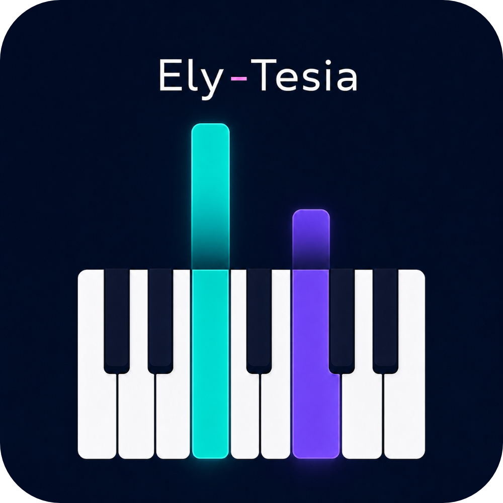
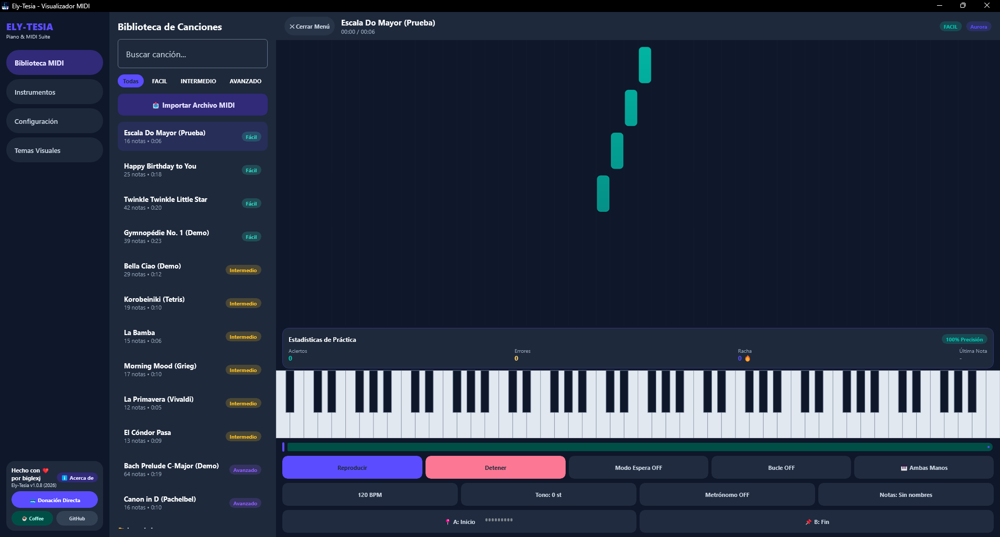
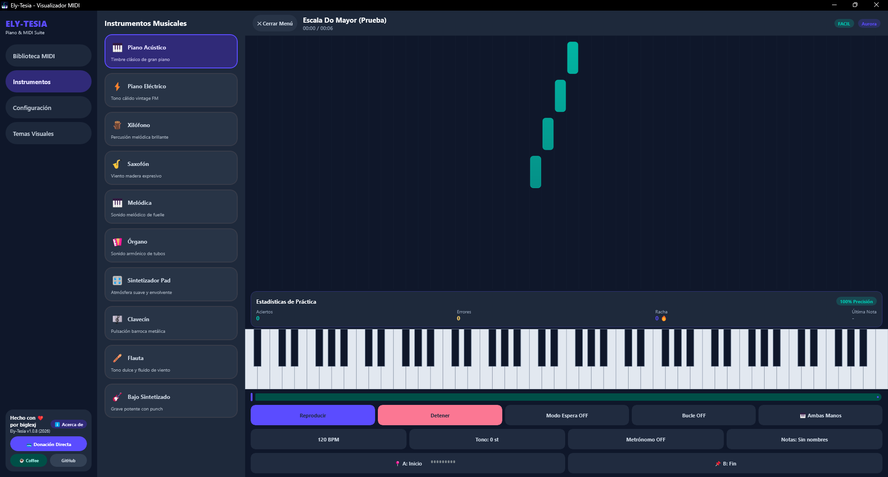
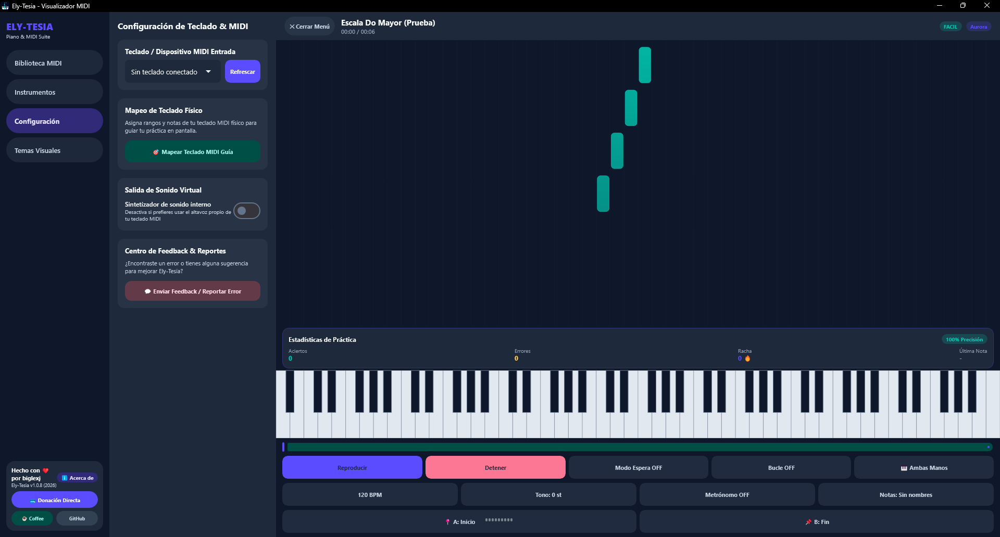
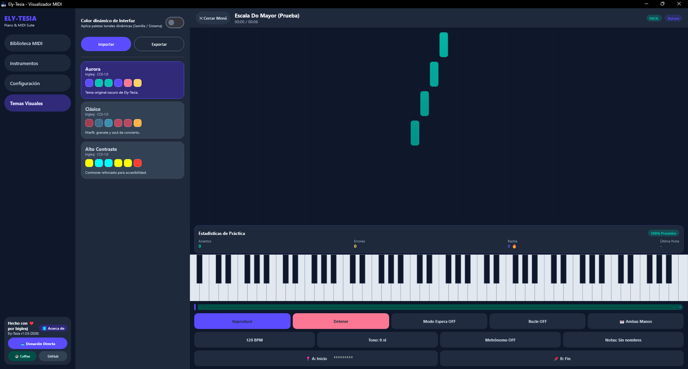
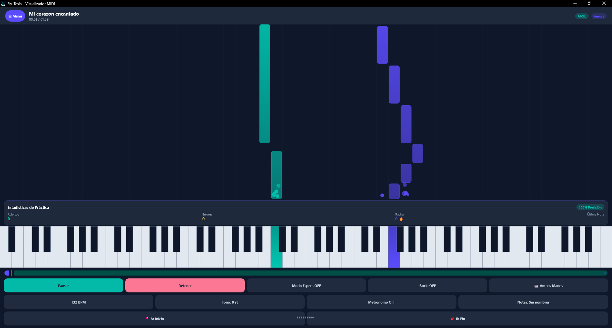
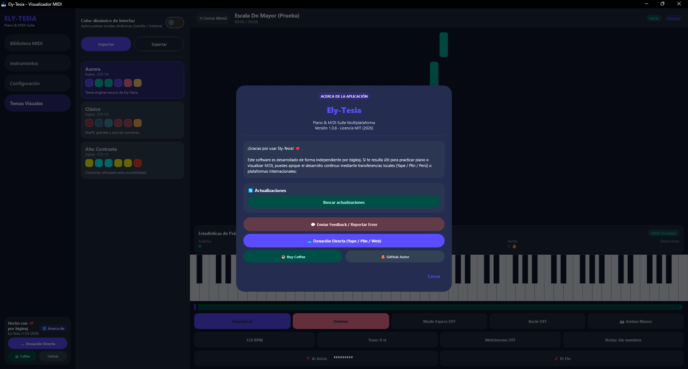

# Ely-Tesia v1.0.9 — Deslizador Continuo en Canvas, Desenfoque de Movimiento & Renderizado a 144 FPS

[](https://github.com/biglexj/Ely-Tesia/releases/latest)
[](https://github.com/biglexj/Ely-Tesia/releases/latest)
[](https://github.com/biglexj/Ely-Tesia/releases/latest)
[](LICENSE)

Ely-Tesia es un visualizador y herramienta de práctica MIDI para Windows y
Android, construido con Kotlin y Compose Multiplatform. Muestra las notas como
barras descendentes sobre un teclado, permite controlar la reproducción y
puede trabajar con un teclado MIDI físico en Windows.



La organización del icono y sus derivados sigue el [Asset Organization Standard](../Docs/global/architecture/asset-organization-standard.md). La fuente canónica es `assets/branding/icons/icon-transparent.png`; los recursos de Compose, Android y MSIX son derivados y no deben editarse manualmente.

## 📸 Capturas de Pantalla

| Biblioteca | Instrumentos |
| :---: | :---: |
|  |  |

| Configuración | Temas |
| :---: | :---: |
|  |  |

| Reproductor | Acerca de |
| :---: | :---: |
|  |  |

## Funciones de la versión 1.0.9

- Carga y visualización de archivos MIDI en Windows y Android.
- Piano roll animado con estela y desenfoque de movimiento vertical.
- Teclado virtual interactivo con mapa de notas por color.
- Entrada desde teclados MIDI físicos en Windows y Android.
- Compatibilidad con teclados Android mediante USB/OTG y Bluetooth MIDI.
- Sintetizador interno de baja latencia en Windows y Android.
- Selección de salida de audio en Windows.
- Alternancia entre el sonido interno y el sonido local del teclado.
- Reproducción, pausa, detención y reinicio.
- Modo de espera para practicar las notas mostradas.
- Modo práctica por mano: izquierda, derecha o ambas.
- Práctica por secciones con bucle A-B.
- Control de BPM, velocidad de reproducción y transposición de tono.
- Metrónomo.
- Reproducción en bucle con una pausa de cinco segundos.
- Línea de tiempo continua en Canvas con arrastre inmediato y avance sub-píxel.
- Cuenta previa configurable de cero, uno o dos compases.
- Mapeo del rango de teclas.
- Biblioteca local persistente entre sesiones.
- Exportación de la canción cargada a archivo MIDI.
- Clasificación automática de dificultad (fácil, intermedio, avanzado).
- Pedal sustain CC64 en la entrada y en la reproducción.
- Interfaz adaptada para escritorio y teléfonos.
- Colores sincronizados por pista en barras, partículas y teclas.
- Evaluación visual de notas correctas e incorrectas con tolerancia temporal.
- Retención del color de cada pulsación hasta soltar la tecla.
- Gestor de temas con Aurora, Clásico y Alto Contraste.
- Importación y exportación de temas comunitarios `.elytheme.json`.
- Colores configurables para manos, teclas blancas, negras/bemoles, pulsaciones,
  errores, estelas y partículas.
- Material 3, movimiento expresivo y Dynamic Color opcional en Android 12+.
- Pantalla activa durante la reproducción en Android.
- APK release firmado con identidad permanente.

## Descargas

Los paquetes oficiales se guardan en la carpeta `release/`:

- `ElyTesia-Setup-1.0.9.exe` — instalador de Windows (Inno Setup, por usuario,
  sin elevación).
- `ElyTesia-Android-1.0.9.apk` — paquete de Android firmado.
- `SHA256SUMS.txt` — hashes SHA-256 de los dos artefactos anteriores.

Desde la versión 1.0.9 la distribución de Windows es **exclusivamente** el
instalador ejecutable `.exe`: los formatos MSI y MSIX quedan descartados. La
migración desde el instalador MSI anterior está documentada en
[`packaging/windows/MIGRATION.md`](packaging/windows/MIGRATION.md).

La firma Android es estable desde la 1.0.5. Si el dispositivo tiene una versión
anterior firmada como debug, Android pedirá desinstalarla una sola vez; desde
entonces las actualizaciones directas conservan la misma identidad.

## Compilar el proyecto

### Requisitos

- Windows 10 u 11 para generar el instalador con Inno Setup.
- JDK 17 completo con `jpackage`.
- Android SDK 34 para generar el APK.
- Inno Setup 6.7+ (`ISCC.exe`) para compilar el instalador de Windows.

El script busca primero Microsoft OpenJDK 17 y utiliza el Android SDK definido
en `ANDROID_HOME` o instalado en `%LOCALAPPDATA%\Android\Sdk`.

### Generar todos los paquetes

Antes de la primera release Android, genera la identidad permanente:

```powershell
.\scripts\setup-android-signing.ps1
```

Guarda una copia privada conjunta de `signing/elytesia-release.jks` y
`keystore.properties`. Ambos están ignorados por Git y perderlos impediría
publicar actualizaciones compatibles.

Desde PowerShell, en la raíz del proyecto:

```powershell
.\build-release.ps1 local -BuildInno
```

`-BuildInno` es obligatorio para generar el instalador oficial de Windows: sin
él se produce el EXE de jpackage heredado, que ya no es el artefacto publicado.

Para generar solamente una plataforma:

```powershell
.\build-release.ps1 local -BuildInno -SkipAndroid
.\build-release.ps1 local -SkipWindows
```

Para firmar el instalador con un certificado Authenticode, proporciona el
certificado sin guardar su contraseña en el repositorio:

```powershell
$password = Read-Host "Contraseña del certificado" -AsSecureString
.\build-release.ps1 local -BuildInno -InstallerCertificate "C:\certificados\ElyTesia.pfx" -InstallerCertificatePassword $password
```

El manifiesto de WinGet se regenera en cada compilación con el `InstallerSha256`
real del instalador, de modo que el hash nunca queda desfasado respecto al
artefacto publicado.

### Ejecutar la aplicación de escritorio

```powershell
$env:JAVA_HOME="C:\Program Files\Microsoft\jdk-17.0.19.10-hotspot"
.\gradlew.bat :composeApp:run
```

## Datos locales

En Windows, la biblioteca, las canciones importadas, el rango mapeado y las
preferencias se almacenan en:

```text
%APPDATA%\Ely-Tesia\state.txt
```

En Android se utiliza el almacenamiento privado de la aplicación.

## Temas comunitarios

Abre **Temas** dentro de la aplicación para aplicar, importar, exportar o
eliminar un tema comunitario. Los temas usan JSON UTF-8 con la extensión
`.elytheme.json`; no contienen código ni recursos remotos y se validan antes de
instalarse.

La guía, las reglas, el esquema y tres ejemplos listos para modificar están en
[`docs/themes/`](docs/themes/README.md).

## Estado del proyecto

Ely-Tesia comenzó como un experimento y continúa en desarrollo. Entre las
funciones previstas están el control avanzado de manos y pistas, la grabación de
interpretaciones, las estadísticas de práctica y una biblioteca comunitaria
opcional.

Las funciones previstas y las ideas que todavía están en evaluación se
mantienen en el [roadmap del proyecto](ROADMAP.md).

## Licencia

Este proyecto se distribuye bajo la [licencia MIT](LICENSE).
